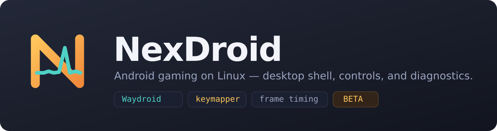
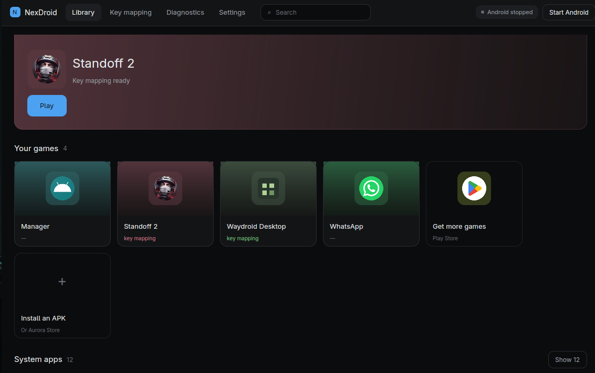
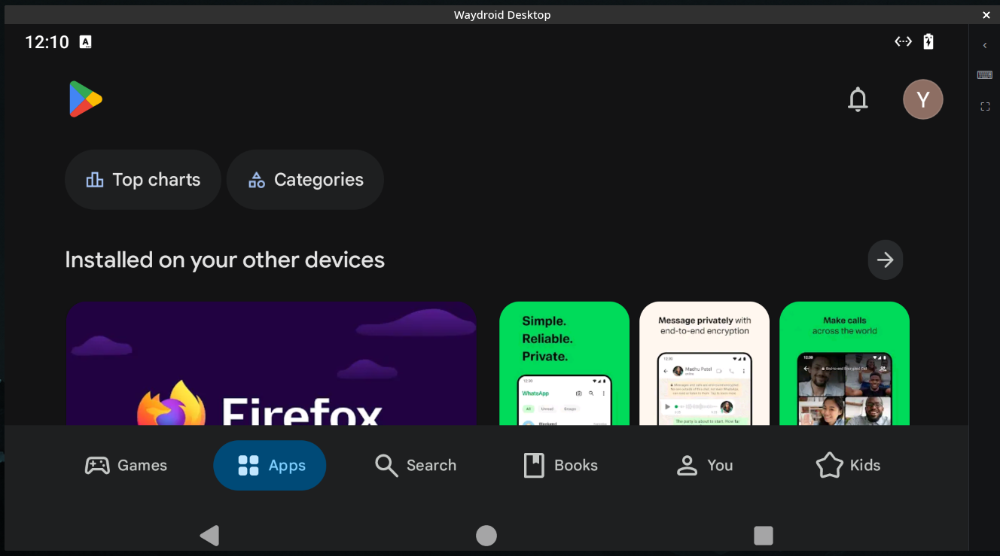
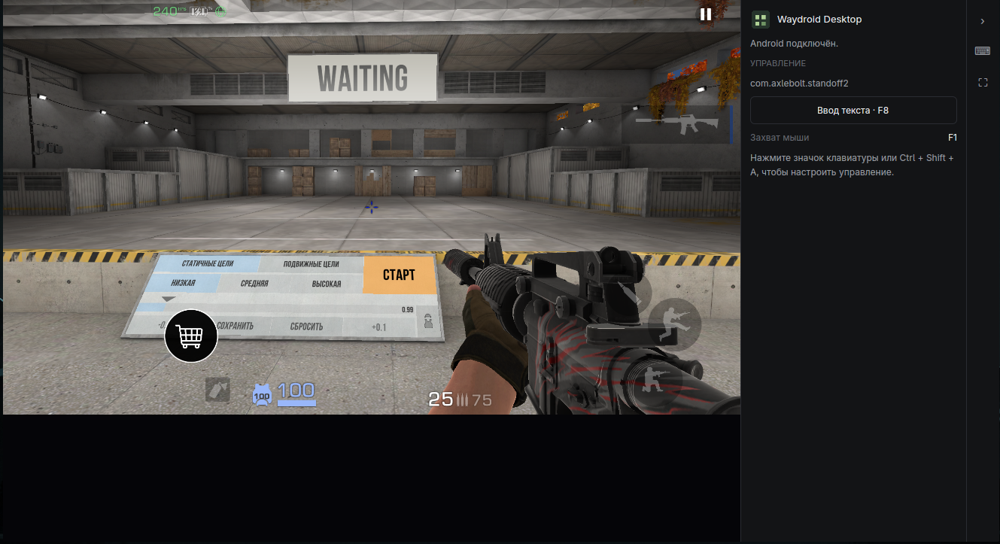
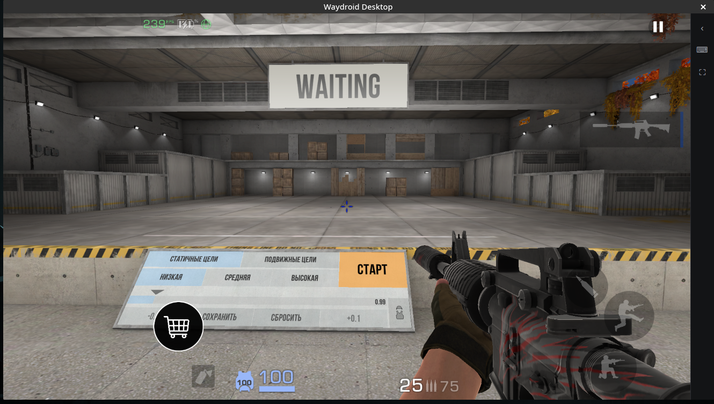
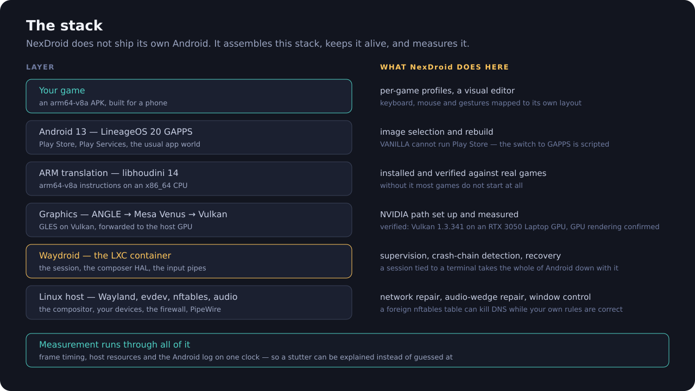
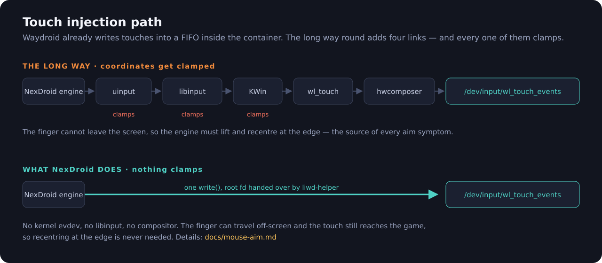
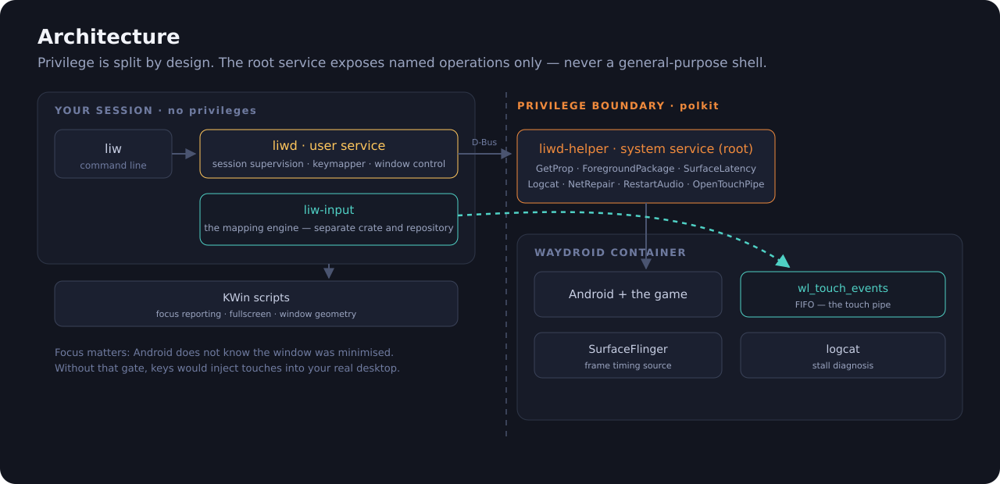

<p align="center">
  <strong>English</strong>
  &nbsp;·&nbsp;
  <a href="README_RU.md"><strong><kbd>🇷🇺 Читать на русском</kbd></strong></a>
</p>

<p align="center">
  
</p>

<p align="center">
  <a href="#status"></a>
  
  
  
</p>

---

> [!WARNING]
> **NexDroid is beta software.** It changes host and Waydroid services, has
> only been exercised on a limited set of machines, and is not yet distributed
> as a distro package. Keep backups and read the installation steps first.

**NexDroid** is a Rust desktop shell and gaming layer for running Android apps
and games through Waydroid on Linux. It puts the Android surface in a dedicated
desktop window, adds per-game keyboard and mouse controls, exposes fullscreen
and emulator-style tools, supervises the Waydroid session, and keeps diagnostic
information close to the user instead of hiding it in terminal commands.

NexDroid is a modified fork of
**[Liwinux](https://github.com/Liwinux-Project/liwinux)**. The upstream Git
history, GPL license and author credits are retained. NexDroid is not presented
as an official Liwinux release.

### Changes in the NexDroid beta

- [standalone bundle](docs/standalone.md): extract and open `NexDroid`; includes
  private Waydroid/Python/LXC runtime and Android, with first-run PolicyKit setup.
  Available in [beta.2](https://github.com/Tunerwachez1/NexDroid/releases/tag/v0.1.0-beta.2);
  the older beta.1 archive does not contain this runtime. GPU/kernel
  requirements and validation limits still apply. Fresh NVIDIA installs use
  [the host driver through glibc-shim](docs/nvidia-host-driver.md), with automatic
  hardware checks instead of a fixed 620.73.04 RM profile.

- [automatic text input](docs/automatic-text-input.md): Android editor focus suspends game bindings; F8 remains a manual override;
- [unified beta installer](docs/unified-install.md) for Arch/CachyOS x86_64: the new full bundle uses included custom Android images with Desktop/HardwareIme and ARMv7/ARM64 (not yet in published beta.1);

- embedded Android window with a native Rust sidebar and real F11 fullscreen;
- Russian control editor with selectable and movable touch controls;
- per-game JSON mappings named `cont_<android.package>.json`;
- WASD joystick, taps, aim/camera capture, left/right mouse and extended keys;
- physical keyboard forwarding, Caps Lock and RU/EN layout state export;
- automatic touch-pipe reconnection after Waydroid recreates its input FIFO;
- Android desktop shortcut, Play Store workflow and NexDroid desktop branding;
- saved display profile, fixed-aspect game window and foreground-app detection;
- NVIDIA-oriented launch fixes plus runtime detection that does not hard-code
  one desktop driver version;
- embedded settings for performance, display, graphics, devices, preferences,
  phone identity, shortcuts, debugging and project information;
- Russian and English settings UI with custom JSON language imports;
- managed Magisk root with per-app approval and verified enable/disable hooks;
- authenticated network ADB, tap/pointer diagnostics and Pixel 6/7/8 profiles;
- 488 automated Rust tests across the current workspace.

## What was fixed compared with Liwinux

**New installation:** download [the beta.2 standalone bundle](https://github.com/Tunerwachez1/NexDroid/releases/tag/v0.1.0-beta.2),
extract it and open `NexDroid`. Android 13, ARM translation and the private
Waydroid runtime are included. The source checkout alone does not contain the
images. Existing data is retained. Fresh NVIDIA installations use the host driver
through glibc-shim; see [requirements and validation](docs/standalone.md).

Most of these fixes were developed before NexDroid's first public snapshot and
were published together in the initial beta commit. The repeated link below is
intentional: separate historical commits did not exist, so no artificial commit
history was created after the fact.

| Bug / symptom | Root cause | NexDroid fix | Commit |
|---|---|---|---|
| Standalone still required a separately installed Waydroid/runtime | Only the desktop application was packaged; Android/container dependencies remained external. | Added a static native launcher, private Linux runtime and clean bundled Android images with first-run provisioning. | [`2c732ce`](https://github.com/Tunerwachez1/NexDroid/commit/2c732ce) |
| NVIDIA updates required an exact precompiled RM profile | The Android backend talked to a version-specific kernel interface. | Added hardware-gated glibc-shim using the host driver for Android and Linux graphics; kept the old native guard. | [`2c732ce`](https://github.com/Tunerwachez1/NexDroid/commit/2c732ce) |
| Payload verification rejected a valid standalone install | The verifier ran inside the runtime namespace and counted its mounted host mirror as extra files. | Run hash/membership verification through bundled Python outside that namespace. | [`2c732ce`](https://github.com/Tunerwachez1/NexDroid/commit/2c732ce) |
| Migrating an existing image path failed during property generation | Regeneration lacked Binder and saved OTA arguments; symlink paths could disagree with LXC mount validation. | Initialize the required arguments from configuration and use canonical runtime paths. | [`2c732ce`](https://github.com/Tunerwachez1/NexDroid/commit/2c732ce) |
| The window could select Intel/Mesa after switching to glibc-shim | Rust graphics selection only treated the source-native mode as requiring NVIDIA. | Apply the NVIDIA GPU requirement to all NVIDIA modes without broadening the exact-RM preflight. | [`2c732ce`](https://github.com/Tunerwachez1/NexDroid/commit/2c732ce) |
| A second launch failed with `The compositor did not start` / `wayland-liw ... already in use` | Every UI process tried to own the same Wayland socket; there was no single-instance request forwarding. | Added a per-user owner lock and local command socket; later launches forward their request to the existing process. | [`0c5984c`](https://github.com/Tunerwachez1/NexDroid/commit/0c5984cde7a6bd16b6cb55dbcfe340b77c0cbfed) |
| Touch stopped working after an Android reconnect and logged `Broken pipe (os error 32)` | Waydroid recreates `wl_touch_events`, leaving the old file descriptor connected to a dead FIFO. | The touch writer now detects failure, reopens the FIFO and reconnects without requiring a full UI restart. | [`0c5984c`](https://github.com/Tunerwachez1/NexDroid/commit/0c5984cde7a6bd16b6cb55dbcfe340b77c0cbfed) |
| Physical typing, Caps Lock and RU/EN switching were unreliable | The embedded Wayland seat did not preserve and forward the complete keymap, layout group and modifier state. | Added physical keymap/group/modifier forwarding and keyboard-state tests. | [`0c5984c`](https://github.com/Tunerwachez1/NexDroid/commit/0c5984cde7a6bd16b6cb55dbcfe340b77c0cbfed) |
| Existing control markers could not be selected, moved or rebound | Editor clicks only placed new controls; there was no marker hit testing or persistent selection. | Added hit testing, selection, drag/click relocation, arrow-key nudging, deletion and rebinding. | [`0c5984c`](https://github.com/Tunerwachez1/NexDroid/commit/0c5984cde7a6bd16b6cb55dbcfe340b77c0cbfed) |
| A WASD joystick could be saved but not move the player | An incomplete four-direction assignment or duplicate trigger could reach the saved profile. | Saving now resumes missing W/A/S/D assignment and rejects incomplete or duplicate bindings. | [`0c5984c`](https://github.com/Tunerwachez1/NexDroid/commit/0c5984cde7a6bd16b6cb55dbcfe340b77c0cbfed) |
| The wrong controls remained active after switching Android apps | Mapping followed the launch request rather than the package that was actually in the foreground. | Added `ForegroundPackage` detection, release of held input and automatic profile switching while excluding launcher/system overlays. | [`0c5984c`](https://github.com/Tunerwachez1/NexDroid/commit/0c5984cde7a6bd16b6cb55dbcfe340b77c0cbfed) |
| Control layouts could collide between games | Legacy profiles were generic and were not consistently keyed by the Android package. | Added atomic per-package JSON profiles named `cont_<package>.json`, with JSON precedence and legacy TOML compatibility. | [`0c5984c`](https://github.com/Tunerwachez1/NexDroid/commit/0c5984cde7a6bd16b6cb55dbcfe340b77c0cbfed) |
| The chosen window size could change after the first click or guest resize | Guest preferred-size updates overrode the host profile, while the pinned GPUI Wayland backend did not enforce `is_resizable`. | Added aspect-fit sizing and restoration of the normal window bounds, while leaving fullscreen/maximized modes alone. | [`0c5984c`](https://github.com/Tunerwachez1/NexDroid/commit/0c5984cde7a6bd16b6cb55dbcfe340b77c0cbfed) |
| F11 hid the sidebar but did not enter real desktop fullscreen | Fullscreen was represented by a local UI flag instead of the Linux window state. | F11 now calls the native window fullscreen toggle; the sidebar follows the real state and Esc/editor mode exits it safely. | [`0c5984c`](https://github.com/Tunerwachez1/NexDroid/commit/0c5984cde7a6bd16b6cb55dbcfe340b77c0cbfed) |
| Long high-FPS sessions accumulated rendered frames in GPU memory | Superseded Android frame images were not retired from the GPUI image atlas. | The renderer keeps only the current and preceding frame and explicitly drops older GPU images. | [`0c5984c`](https://github.com/Tunerwachez1/NexDroid/commit/0c5984cde7a6bd16b6cb55dbcfe340b77c0cbfed) |
| The window sometimes stayed black with “Android input is not connected” while the container was healthy | The UI treated cached daemon health as proof that the new window owned the Android session, while Android could still be attached to the previous compositor socket. | Added an atomic embedded-display handoff: stop the old session, assign the new owner/socket, and report ready only after a new frame and input connection. | [`7619fdb`](https://github.com/Tunerwachez1/NexDroid/commit/7619fdb) |
| At 1920×1080 and high refresh rates such as 360 Hz, the picture could crop or stretch | The host framebuffer size was advertised as a new native Android output and the damage tracker used a 1:1 scale. | Native Android resolution is now independent from window size; frames are scaled locally with the correct damage scale and aspect ratio. | [`7619fdb`](https://github.com/Tunerwachez1/NexDroid/commit/7619fdb) |
| Saving CPU and memory limits requested the administrator password every time | Each save was treated as a new privileged action without a narrow persistent grant for NexDroid settings. | Added a dedicated PolicyKit action for fixed Android settings and a root-owned per-UID remembered grant. | [`7619fdb`](https://github.com/Tunerwachez1/NexDroid/commit/7619fdb) |
| Network ADB could remain stuck in `stopping` | Android init reported a transitional state while a hung `adbd` process remained without a usable TCP listener. | The helper checks the real port 5555 listener, waits for a clean stop, terminates only a stuck `adbd`, then starts and verifies it again. | [`7619fdb`](https://github.com/Tunerwachez1/NexDroid/commit/7619fdb) |
| Opening game chat required manually toggling F8 every time | The host keymapper received no Android editor focus events. | HardwareIme now sends EditorInfo/InputConnection metadata to Rust; game bindings suspend/resume automatically, with F8 retained as a manual override. | [`87afe8e`](https://github.com/Tunerwachez1/NexDroid/commit/87afe8e) |
| Standoff chat closure could not be detected reliably from the input-started flag | Android kept `mInputStarted=true` after the editor and InputConnection were gone. | TYPE_NULL and InputConnection are checked, transient editor finish/start transitions are coalesced, and held keys are released on mode changes. | [`87afe8e`](https://github.com/Tunerwachez1/NexDroid/commit/87afe8e) |

## Screenshots

| Library | Google Play inside NexDroid |
|---|---|
|  |  |

| Game window with the native sidebar | Fullscreen gameplay |
|---|---|
|  |  |

The project still uses the internal `liw`, `liwd` and `id.liwinux.*` names for
compatibility with upstream profiles, services and D-Bus clients.

Getting there takes more than a key mapper. A phone game is arm64 code
expecting a GPU, a Play Store account, a network and a touchscreen — on a
desktop, every one of those has to be arranged. NexDroid arranges them, keeps
them alive when they break, and **measures** whether any of it actually helped.

```bash
liw session start            # bring Android up, detached from your terminal
liw keymap start --grab      # map keyboard and mouse into the game
liw bench com.some.game      # frame timing and host resource use
liw trace com.some.game      # find out WHY it stutters
```

---

## The stack

<p align="center">
  
</p>

NexDroid does not ship its own Android, and it does not pretend to have written
[Waydroid](https://waydro.id/), libhoudini or Mesa. What it does is make that
stack into something you can actually play on:

| Layer | What was needed | What NexDroid does |
|---|---|---|
| **GPU** | mobile games expect a GPU; a container does not have one | sets up and verifies the NVIDIA path — ANGLE (GLES→Vulkan) over Mesa Venus. Measured on this machine: **Vulkan 1.3.341, NVIDIA GeForce RTX 3050 Laptop GPU, GPU rendering confirmed**, not software fallback |
| **CPU** | games ship arm64-v8a; the host is x86_64 | installs and verifies **libhoudini 14**, then proves it with a real arm64 game rather than a synthetic check |
| **Android image** | Play Store does not work on the VANILLA image | scripted rebuild to **LineageOS 20 GAPPS**, with the microG/signature-spoofing traps documented |
| **Network** | the container silently loses DNS | diagnoses and repairs it — including the case where a *foreign* nftables table hijacks DNS while your own firewall rules are perfectly correct |
| **Audio** | a wedged audio HAL freezes every app at its loading screen | detects the wedge from the log and restarts the HAL, instead of restarting all of Android |
| **Session** | `waydroid session start` runs in the foreground and takes Android down with it | owns the session detached from any terminal, watches six health signals, recovers |
| **Input** | there is no keyboard or mouse in a phone game | a mapping engine with joystick, taps, gestures and **unbounded FPS aim** |
| **Measurement** | "it feels laggy" is not actionable | frame timing, host resources and the Android log on one clock |

Each of those rows is a bug that cost real hours. The network one looked like
"Play Store has no internet". The audio one looked like "the game will not
open". Neither symptom resembles its cause, which is why the diagnosis is in
the tool and not in a wiki page.

---

## What NexDroid itself is

### An emulator that supervises rather than reimplements

`waydroid session start` runs in the foreground. When it dies the composer HAL
goes with it, then `system_server`, then every app — and Android does not fully
recover: the default route never comes back, leaving a network-less zombie whose
symptom looks nothing like the cause.

`liwd` owns the session instead, detached from any terminal, and watches six
separate health signals rather than one boolean:

```
$ liw session health
  ✓ session running
  ✓ container running
  ✓ composer HAL alive
  ✓ composer connection fresh
  ✓ Android boot completed
  ✓ IP assigned
```

The fourth exists because a composer that restarted *after* the session leaves a
stale binder connection: everything looks alive, but no window appears and
`waydroid app launch` returns `Sending reply failed`.

### A mouse that does not fight you

This is the part with no equivalent elsewhere.

Keyboard mappers for Android inject at the framework level
(`InputManager.injectInputEvent`, usually through an `app_process` service). By
then the coordinates have been fitted into screen space, so the mouse cannot
travel past the edge of the display. Every such project then has to lift the
finger and put it back at the centre, and anyone who has used one knows how that
feels: the aim stutters, sometimes it stops registering for a second, sometimes
it drifts.

<p align="center">
  
</p>

Waydroid's patched `EventHub` reads touches from a FIFO inside the container.
Nothing on that path clamps — there is no kernel evdev layer,
`TouchInputMapper` does not clamp, and `InputDispatcher` does not re-pick a
window on MOVE. So a finger that goes down inside the game keeps reaching it
even when it wanders off-screen, and the whole recentring problem simply does
not arise.

The reasoning, the source references and the verification procedure are in
[`docs/mouse-aim.md`](docs/mouse-aim.md). The engine itself lives in
**[liwinux-keymapper](https://github.com/Liwinux-Project/liwinux-keymapper)**.

Profiles are per-game TOML in normalized coordinates, so they survive a
resolution change:

```toml
[bindings.move]
type = "joystick"
up = { Key = 17 }                # W
center = { x = 0.148, y = 0.738 }
radius = 0.085

[bindings.look]
type = "aim"
origin = { x = 0.5004, y = 0.50 }
sensitivity = 0.0006
unbounded = true
```

And you place them by dragging markers over a screenshot of the game:

```bash
liw profile edit com.some.game
```

### Numbers instead of adjectives

`liw bench` samples `SurfaceFlinger --latency` and correlates it with host GPU,
CPU, VRAM and memory pressure. A real run, on Special Forces Group 2:

```
FRAMES 5016 intervals, 5018 unique frames, coverage 91%
       the game is locked to 60 FPS (display 180 Hz)
  p50 16.67 ms (60 FPS)   p99 22.34 ms   worst 33.31 ms   jank>1.5x 0.22%

HOST   GPU  mean 53.6%  peak 82.0%     CPU  mean 37.3%  peak 54.8%
```

Jank is measured against the **game's** frame period, not the display refresh.
An earlier version compared against the 180 Hz refresh and reported 99.8% jank
for a game that was drawing perfectly steadily at 60 — the metric was wrong, not
the game.

`liw trace` goes further and answers *why*. It puts frame timing, the Android
log and host samples on one clock (`CLOCK_MONOTONIC`) and reports what was
happening during each stall:

```
VERDICT
  ▸ ad mediation stack — in 2/11 stutters
    The SDK tries several ad networks in turn and decodes the video ad in
    software — Waydroid has no hardware video decoder.
```

That verdict is real. An "8-second freeze" that looked like a system fault
turned out to be the game's own ad SDK.

`liw perf status` reports the tuning levers it can see — CPU governor, EPP,
NVIDIA PowerMizer, frame budget, container CPU weight — and refuses to claim any
of them helps until it has been measured.

---

## Architecture

<p align="center">
  
</p>

Three processes, split by privilege:

| | Runs as | Does |
|---|---|---|
| `liw` | you | the command line; talks to `liwd`, or straight to Waydroid if the daemon is absent |
| `liwd` | your user | session supervision, the keymapper, window control |
| `liwd-helper` | root | the few operations that genuinely need it |

**`liwd-helper` deliberately exposes no `Shell()` method.** A general-purpose
shell interface would hand every local user a path to root execution, even
behind polkit. Instead it offers narrow named operations — `GetProp`,
`ForegroundPackage`, `SurfaceLatency`, `Logcat`, `NetRepair`, `RestartAudio`,
`OpenTouchPipe` — each bound to its own polkit action with its inputs validated.

`OpenTouchPipe` returns a file descriptor rather than proxying writes, so
authorization is asked once and the 200 Hz write traffic never crosses IPC.

---

## Build and install

NexDroid currently targets Linux with Wayland. A working Waydroid installation
is required. The tested desktop is KWin; other compositors may need additional
window-control integration. See [`DEPENDENCIES.txt`](DEPENDENCIES.txt) before
building.

```bash
git clone https://github.com/Tunerwachez1/NexDroid.git
cd NexDroid
cargo build --release --workspace

install -Dm755 target/release/liw   ~/.local/bin/liw
install -Dm755 target/release/liwd  ~/.local/bin/liwd
install -Dm755 target/release/liw-ui ~/.local/bin/liw-ui
install -Dm644 dist/systemd/liwd.service ~/.config/systemd/user/liwd.service
install -Dm644 -t ~/.local/share/liwinux/kwin scripts/kwin/*.js
./dist/install-desktop.sh
systemctl --user daemon-reload
systemctl --user enable --now liwd.service

sudo bash dist/install-helper.sh    # the root service, its polkit policy and D-Bus config
```

Launch the library or the Android desktop:

```bash
liw-ui
liw-ui --game dev.waydroid.manager.home
```

The build is locked by `Cargo.lock`. Use `cargo build --release --workspace`,
not the shorter root command: the upstream workspace intentionally excludes the
large UI and compositor crates from its default members.

Then calibrate your keyboard and mouse — do not guess, measure:

```bash
liw keymap detect --save           # press a key
liw keymap detect --mouse --save   # move the mouse
liw keymap detect --hotkey --save  # pick the game-mode key
```

Calibration writes a stable `/dev/input/by-id/...` path. `eventN` numbers are
not stable across reboots; on this machine `event23` was the keyboard one day
and an HDMI audio device the next, and the keymapper silently stopped working.

The stack setup itself is scripted, with what each step verifies written next
to it: `scripts/poc/poc0-verify.sh` (GPU rendering), `poc1-arm.sh` (houdini),
`scripts/rebuild-gapps.sh` (the GAPPS image) and `scripts/liw-net-doctor.sh`
(the network).

---

## Status

**Public beta.** The current branch builds and all 488 tests pass, but this is
not a promise that every Waydroid image, GPU driver or desktop compositor works.
The active development system is CachyOS/Arch, KWin on Wayland, an
**NVIDIA GeForce RTX 3050 Laptop GPU**, and Waydroid Android 13 with Google
Apps and ARM translation. NVIDIA is the best exercised path. AMD and Intel
need independent reports and wider testing.

Known to work:

- the full stack: GPU acceleration, ARM translation, Play Store, networking
- session supervision, crash-chain detection, automatic recovery
- network repair, including foreign-firewall diagnosis
- audio-wedge detection and repair
- keyboard and mouse mapping with sub-millisecond engine latency (p99 0.17 ms
  for our own layer — that measurement covers our layer only, and says so)
- unbounded FPS aim through the touch pipe
- frame timing, stall correlation, lever diagnosis

Not done:

- the performance levers are diagnosed but not yet applied or measured
- window-mode coordinate mapping is plumbed but untested; fullscreen is assumed
- tested on KWin only; other compositors need their own focus and geometry scripts
- AMD and Intel GPU paths are untouched — only the NVIDIA path was built and measured
- no packaging yet

---

## Repository layout

```
crates/liw           the command line
crates/liwd          the user service
crates/liwd-helper   the root service
crates/liw-core      Waydroid, session health, bench, trace, perf
crates/liw-input     the mapping engine  (mirrored to liwinux-keymapper)
docs/mouse-aim.md    why the aim problem exists and how it was removed
profiles/            example game profiles
dist/                systemd units, polkit policy, D-Bus config
scripts/poc/         stack setup and verification: GPU, houdini, GAPPS, DNS
scripts/kwin/        compositor scripts
```

Tests are behavioural, not incidental: 488 of them, and most encode a bug that
actually happened. `overlapping_snapshots_do_not_inflate_sample_count` exists
because a measurement once reported 23560 intervals from 7997 frames.

---

## Credits

NexDroid is based on [Liwinux](https://github.com/Liwinux-Project/liwinux).
Original Liwinux commits and authors remain in Git history. The project also
stands on work from the wider community:

- [Waydroid](https://waydro.id/) — the container and the Android integration
- [waydroid-nvidia](https://github.com/rekulous/waydroid-nvidia) — the NVIDIA/Venus path
- [waydroid_script](https://github.com/casualsnek/waydroid_script) — houdini and GAPPS installation
- [XtMapper](https://github.com/Xtr126/XtMapper) (GPL-3) — the non-linear aim scaling and
  delayed-reset idea, on which the earlier bounded implementation was built

## License

GNU General Public License v3.0 or later (`GPL-3.0-or-later`). See
[`LICENSE`](LICENSE) and [`FORK_NOTICE.md`](FORK_NOTICE.md). There is no
warranty. Modified versions must preserve the license and corresponding source
requirements.

## Desktop front end

`liw-ui` is a gpui application: one Rust binary, no web runtime. It is a
**viewport onto `liwd`** — every fact it draws is a daemon property with a
change signal, so it redraws when something happens rather than on a timer.

It is also disposable. All state lives in the daemon, so closing the window
changes nothing about a running session.

**It never sits on top of the game.** KWin can hand a fullscreen window
straight to the display; an always-on-top overlay closes that path and forces
full composition, which costs frames exactly where they matter. A GameLoop
style sidebar over the game is the one thing this deliberately does not do.

### Artwork

```bash
liw art list com.ForgeGames.SpecialForcesGroup2   # what its APK might offer
liw art dump <package> /tmp/art                   # extract them to look at
liw art use  <package> 0                          # or a path to your own image
```

Artwork is a file the user picks, and the APK is only a source of
candidates. Pulling it automatically was measured on three installed apps
and does not work: for Special Forces Group 2 the largest square image is
a **speaker glyph** from the volume UI, Subway Surfers' widest image is a
**Mintegral ad banner**, and Instagram's is a filter atlas. No size or
aspect rule separates key art from ad assets, and guessing wrong puts
someone else's advertisement on your game.

The filter narrows hundreds of images to a shortlist — Special Forces
Group 2 comes back with exactly its two 1280x720 key-art frames, Subway
Surfers with nothing at all — and a person chooses. Without artwork the
hero falls back to the icon's own colour, so the layout never has a hole
where a picture should be.

### Getting games

The library's last two cards are **Get more games** (opens the Play Store)
and **Install an APK** (a file picker). Aurora Store is the other sensible
source and installs the same way.

NexDroid does not have a catalogue and will not grow one. Browsing Play
needs Play API auth: the user's own Google credentials, or somebody
else's pooled anonymous accounts like the dispenser Aurora Store runs.
Aurora already solves that in a client built to ask the account question
properly; pointing a different product at its dispenser would be leeching
infrastructure they pay for, and one outage from a dead front page.

There was briefly a "Store" tab. Without a catalogue the name promised
something it could not do, so it is gone and its parts went where they
belong — profiles to **Key mapping**, install actions to the library.

## Control plane

`liwd` owns the session and exposes it on the session bus as
`id.liwinux.Manager1`, so a UI does not have to drive the CLI:

* **Properties**, all announcing changes: `State`, `HealthJson`,
  `KeymapperRunning`, `GameMode`, `Grabbed`, `HostFocused`,
  `ActiveProfile`, `ForegroundPackage`. `HealthJson` is served from the
  supervision loop's cache — `Health()` still measures on demand, and it
  is expensive enough that nothing should poll it.
* **Signal** `KeymapperEvent(kind, detail)` for things that are not
  state: a system overlay covering the game, an escape request, a
  profile file changing on disk.
* **Profiles**: `ListProfiles`, `GetProfile`, `SaveProfile`,
  `DeleteProfile`. Writes preserve the file's comments, and editing a
  system profile creates a user file that shadows it rather than
  changing it in place.
* **Errors carry names** — `id.liwinux.Error.NoSession`, `.NoHelper`,
  `.NoProfile`, `.NoWindow`, `.Invalid`, `.Failed` — so a client can
  branch instead of matching on prose.

