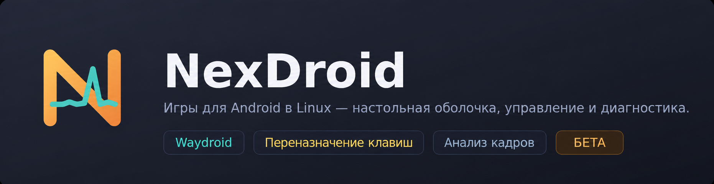
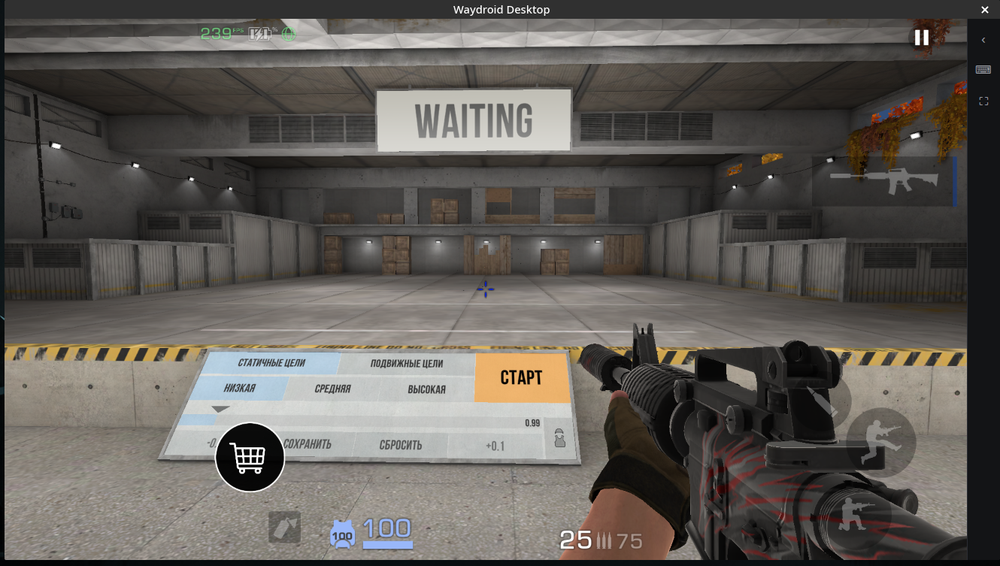

<p align="center">
  <a href="README.md"><strong><kbd>🇬🇧 Read in English</kbd></strong></a>
  &nbsp;·&nbsp;
  <strong>Русский</strong>
</p>

<p align="center">
  
</p>

<p align="center">
  <a href="#статус"></a>
  
  
  
</p>

---

> [!WARNING]
> **NexDroid находится на стадии beta-тестирования.** Программа меняет
> пользовательские и системные службы Waydroid, проверена на
> ограниченном количестве компьютеров и пока не выпускается в виде
> готового пакета для дистрибутива. Перед установкой сделайте резервные
> копии важных данных.

# Что такое NexDroid

**NexDroid** — это написанная на Rust оболочка и игровой слой для
запуска Android-приложений через Waydroid на Linux. Android отображается
в отдельном окне с боковой панелью, полноэкранным режимом,
клавиатурно-мышиным управлением и диагностикой.

NexDroid — изменённый форк
**[Liwinux](https://github.com/Liwinux-Project/liwinux)**. История Git,
лицензия GPL и авторство upstream сохранены. NexDroid не является
официальным релизом Liwinux.

## Изменения NexDroid beta

- Android встроен в нативное Rust-окно с боковой панелью;
- F11 включает настоящий полноэкранный режим;
- русский редактор экранного управления;
- профили управления для каждой игры в `cont_<android.package>.json`;
- WASD-джойстик, нажатия, прицел, захват курсора, ЛКМ, ПКМ и
  расширенные клавиши;
- передача физической клавиатуры, Caps Lock и состояния раскладки RU/EN;
- автоматическое переподключение к каналу касаний Waydroid;
- ярлык рабочего стола Android и сценарий Google Play;
- сохраняемый профиль экрана и окно с фиксированными пропорциями;
- определение активной Android-игры для автовыбора профиля;
- исправления запуска с NVIDIA без привязки к одной desktop-версии
  драйвера;
- 458 автоматизированных Rust-тестов.

Внутренние имена `liw`, `liwd`, `liwinux` и `id.liwinux.*` пока сохранены
для совместимости с профилями, службами и D-Bus API Liwinux.

## Скриншоты

| Библиотека NexDroid | Google Play внутри NexDroid |
|---|---|
|  |  |

| Игровое окно с боковой панелью | Полноэкранная игра |
|---|---|
|  |  |

## Сборка и установка

Требуется Linux с Wayland и уже работающая установка Waydroid. Основной
проверенный композитор — KWin. Пакеты для Arch/CachyOS и GPU-примечания
перечислены в [`DEPENDENCIES.txt`](DEPENDENCIES.txt).

```bash
git clone https://github.com/Tunerwachez1/NexDroid.git
cd NexDroid
cargo build --release --workspace

install -Dm755 target/release/liw ~/.local/bin/liw
install -Dm755 target/release/liwd ~/.local/bin/liwd
install -Dm755 target/release/liw-ui ~/.local/bin/liw-ui
install -Dm644 dist/systemd/liwd.service ~/.config/systemd/user/liwd.service
install -Dm644 -t ~/.local/share/liwinux/kwin scripts/kwin/*.js
./dist/install-desktop.sh
systemctl --user daemon-reload
systemctl --user enable --now liwd.service

sudo bash dist/install-helper.sh
```

Нужно собирать всё рабочее пространство через `--workspace`. Обычная команда
`cargo build --release` не собирает тяжёлые UI-крейты, так как это было
намеренно задано в upstream.

## Запуск

```bash
liw-ui
liw-ui --game dev.waydroid.manager.home
```

Первая команда открывает библиотеку NexDroid. Вторая сразу открывает
рабочий стол Android.

## Основные горячие клавиши

- `F11` — полный экран и возврат в оконный режим;
- `Esc` — освободить курсор или выйти из полного экрана;
- `F1` — включить или выключить захват курсора для камеры;
- `F8` — режим ввода текста в Android;
- `Ctrl+Shift+A` — открыть редактор управления.

## Архитектура

| Компонент | Назначение |
|---|---|
| `liw-ui` | Библиотека, игровое окно, боковая панель и редактор управления |
| `liw-compositor` | Встроенный Wayland-композитор для Android-поверхности |
| `liwd` | Пользовательская служба сессии, окон и управления |
| `liwd-helper` | Ограниченные привилегированные операции через polkit |
| `liw-input` | Преобразование клавиатуры и мыши в Android-касания |
| `liw` | Инструмент командной строки, тесты и диагностика |

## Статус

NexDroid — **публичная beta**. Текущая ветка собирается, а 458 тестов
проходят, но это не означает, что поддерживается каждый Android-образ,
GPU-драйвер и Wayland-композитор. Лучше всего проверены CachyOS/Arch,
KWin, **NVIDIA GeForce RTX 3050 Laptop GPU**, Android 13, Google Apps и
ARM-трансляция. AMD и Intel нуждаются
в более широком независимом тестировании.

## Авторство и лицензия

NexDroid основан на [Liwinux](https://github.com/Liwinux-Project/liwinux) и
использует Waydroid, наработки `waydroid-nvidia`, `waydroid_script`, XtMapper и другие
компоненты сообщества. Подробности сохранены в английском
[`README.md`](README.md) и [`FORK_NOTICE.md`](FORK_NOTICE.md).

Проект распространяется по **GNU General Public License v3.0 или более новой
версии (`GPL-3.0-or-later`)**. См. [`LICENSE`](LICENSE). Программа поставляется
без гарантий.
