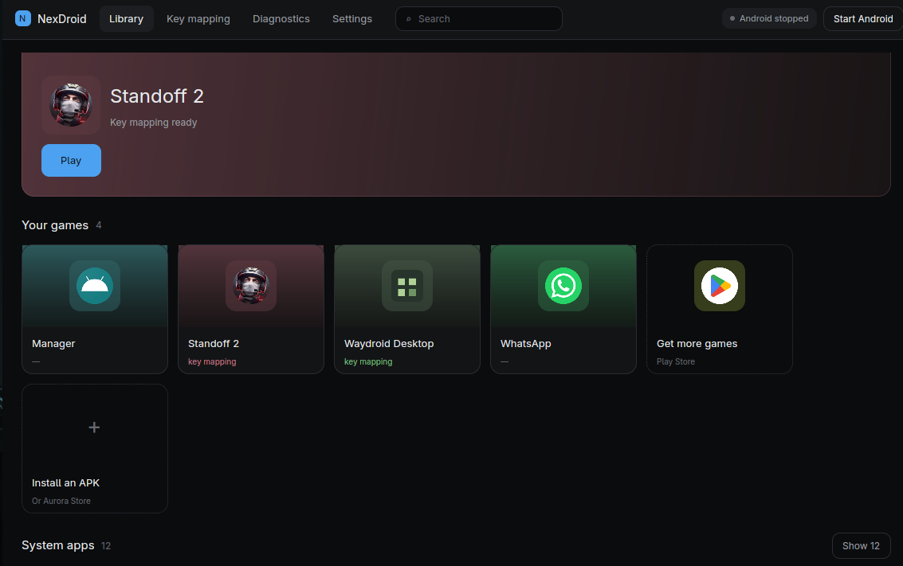
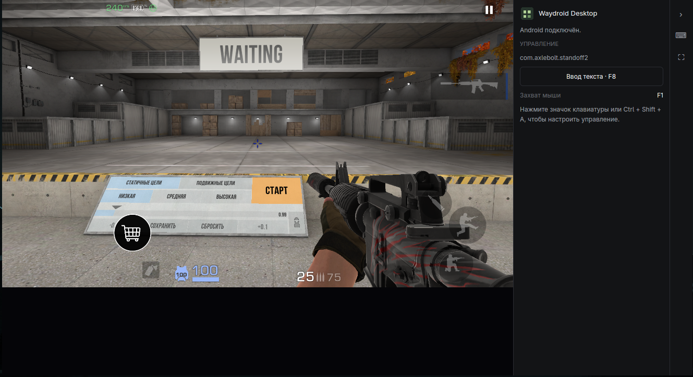

<p align="center">
  <a href="README.md"><strong><kbd>🇬🇧 Read in English</kbd></strong></a>
  &nbsp;·&nbsp;
  <strong>Русский</strong>
</p>

<p align="center">
  
</p>

<p align="center">
  <a href="#статус"></a>
  
  
  
</p>

---

> [!WARNING]
> **NexDroid находится на стадии beta-тестирования.** Программа меняет
> пользовательские и системные службы Waydroid, проверена на
> ограниченном количестве компьютеров и пока не выпускается в виде
> готового пакета для дистрибутива. Перед установкой сделайте резервные
> копии важных данных.

# Что такое NexDroid

**NexDroid** — это написанная на Rust оболочка и игровой слой для
запуска Android-приложений через Waydroid на Linux. Android отображается
в отдельном окне с боковой панелью, полноэкранным режимом,
клавиатурно-мышиным управлением и диагностикой.

NexDroid — изменённый форк
**[Liwinux](https://github.com/Liwinux-Project/liwinux)**. История Git,
лицензия GPL и авторство upstream сохранены. NexDroid не является
официальным релизом Liwinux.

## Изменения NexDroid beta

- Android встроен в нативное Rust-окно с боковой панелью;
- F11 включает настоящий полноэкранный режим;
- русский редактор экранного управления;
- профили управления для каждой игры в `cont_<android.package>.json`;
- WASD-джойстик, нажатия, прицел, захват курсора, ЛКМ, ПКМ и
  расширенные клавиши;
- передача физической клавиатуры, Caps Lock и состояния раскладки RU/EN;
- автоматическое переподключение к каналу касаний Waydroid;
- ярлык рабочего стола Android и сценарий Google Play;
- сохраняемый профиль экрана и окно с фиксированными пропорциями;
- определение активной Android-игры для автовыбора профиля;
- исправления запуска с NVIDIA без привязки к одной desktop-версии
  драйвера;
- встроенные настройки производительности, экрана, графики, устройств,
  предпочтений, профиля телефона, горячих клавиш и отладки;
- русский и английский интерфейс настроек с импортом собственных переводов
  из JSON;
- управляемые root-права Magisk с отдельным подтверждением запросов приложений,
  безопасным включением и отключением при перезапуске Android;
- сетевой ADB с сохранённой авторизацией, показ касаний и координат указателя;
- профили Google Pixel 6, Pixel 7 и Pixel 8 без удаления данных приложений;
- 488 автоматизированных Rust-тестов.

## Что исправлено относительно Liwinux

Большинство этих исправлений разрабатывалось до первой публичной фиксации
NexDroid и было опубликовано одним начальным beta-коммитом. Поэтому ссылка в
таблице повторяется: отдельных исторических коммитов не существовало, а
создавать искусственную историю задним числом мы не стали.

| Баг / проявление | Причина | Исправление в NexDroid | Коммит |
|---|---|---|---|
| Для готовой оболочки всё ещё требовалась отдельная установка Waydroid | Упаковывался UI, но Android и зависимости контейнера оставались внешними. | Добавлены статический запускатель, private runtime и чистые образы Android с первичной подготовкой. | [`2c732ce`](https://github.com/Tunerwachez1/NexDroid/commit/2c732ce) |
| Обновление NVIDIA требовало заранее собранного RM-профиля | Android-бэкенд обращался к зависящему от версии интерфейсу модуля ядра. | Добавлен аппаратно проверяемый glibc-shim с библиотеками системного драйвера для Android и Linux-графики; guard native-режима сохранён. | [`2c732ce`](https://github.com/Tunerwachez1/NexDroid/commit/2c732ce) |
| Проверка целостности отвергала корректный standalone | Проверка внутри runtime namespace считала подключённый host mirror лишними файлами. | Проверять hashes и состав файлов через комплектный Python вне этого namespace. | [`2c732ce`](https://github.com/Tunerwachez1/NexDroid/commit/2c732ce) |
| Миграция существующего images_path прерывалась при генерации свойств | Не инициализировались Binder/OTA аргументы; symlink-пути расходились с проверкой LXC mounts. | Загружать необходимые аргументы из конфигурации и использовать canonical runtime paths. | [`2c732ce`](https://github.com/Tunerwachez1/NexDroid/commit/2c732ce) |
| После перехода на glibc-shim окно могло выбрать Intel/Mesa | Rust принудительно выбирал NVIDIA только в source-native режиме. | Выбор NVIDIA распространён на все NVIDIA-режимы; exact-RM preflight остаётся отдельной проверкой. | [`2c732ce`](https://github.com/Tunerwachez1/NexDroid/commit/2c732ce) |
| Повторный запуск завершался сообщением `The compositor did not start` / `wayland-liw ... already in use` | Каждый процесс UI пытался занять один Wayland-сокет; передачи запроса уже запущенному экземпляру не было. | Добавлены блокировка владельца для пользователя и локальный командный сокет: следующие запуски передают запрос существующему процессу. | [`0c5984c`](https://github.com/Tunerwachez1/NexDroid/commit/0c5984cde7a6bd16b6cb55dbcfe340b77c0cbfed) |
| После переподключения Android пропадали касания и появлялся `Broken pipe (os error 32)` | Waydroid пересоздаёт `wl_touch_events`, а старый файловый дескриптор остаётся подключён к мёртвому FIFO. | Запись касаний определяет обрыв, заново открывает FIFO и переподключается без полного перезапуска UI. | [`0c5984c`](https://github.com/Tunerwachez1/NexDroid/commit/0c5984cde7a6bd16b6cb55dbcfe340b77c0cbfed) |
| Физическая клавиатура, Caps Lock и переключение RU/EN работали нестабильно | Встроенный Wayland-seat не сохранял и не передавал полное состояние keymap, группы раскладки и модификаторов. | Добавлена передача keymap/group/modifiers и тесты состояния клавиатуры. | [`0c5984c`](https://github.com/Tunerwachez1/NexDroid/commit/0c5984cde7a6bd16b6cb55dbcfe340b77c0cbfed) |
| Уже созданную кнопку управления нельзя было выбрать, передвинуть или переназначить | Нажатие в редакторе только создавало новый элемент; проверки попадания по маркеру и постоянного выбора не было. | Добавлены hit testing, выбор, перенос кликом/перетаскиванием, сдвиг стрелками, удаление и переназначение. | [`0c5984c`](https://github.com/Tunerwachez1/NexDroid/commit/0c5984cde7a6bd16b6cb55dbcfe340b77c0cbfed) |
| WASD-джойстик сохранялся, но персонаж не двигался | В профиль могла попасть незавершённая привязка четырёх направлений или повторяющийся триггер. | Сохранение продолжает назначение недостающих W/A/S/D и отклоняет неполные либо дублирующиеся привязки. | [`0c5984c`](https://github.com/Tunerwachez1/NexDroid/commit/0c5984cde7a6bd16b6cb55dbcfe340b77c0cbfed) |
| После переключения Android-приложения оставалось управление от другой игры | Профиль выбирался по запросу запуска, а не по реально активному Android-пакету. | Добавлены `ForegroundPackage`, отпускание зажатого ввода и автоматическая смена профиля с исключением launcher/system overlay. | [`0c5984c`](https://github.com/Tunerwachez1/NexDroid/commit/0c5984cde7a6bd16b6cb55dbcfe340b77c0cbfed) |
| Раскладки управления разных игр могли пересекаться | Старые профили были общими и не всегда привязывались к имени Android-пакета. | Добавлены атомарные JSON-профили `cont_<package>.json` для каждой игры, приоритет JSON и совместимость со старыми TOML. | [`0c5984c`](https://github.com/Tunerwachez1/NexDroid/commit/0c5984cde7a6bd16b6cb55dbcfe340b77c0cbfed) |
| Выбранный размер окна менялся после первого клика или изменения размера гостем | Preferred-size от Android перезаписывал профиль хоста, а закреплённый GPUI Wayland backend не соблюдал `is_resizable`. | Добавлены расчёт размера с сохранением пропорций и восстановление обычных границ окна без вмешательства в fullscreen/maximized. | [`0c5984c`](https://github.com/Tunerwachez1/NexDroid/commit/0c5984cde7a6bd16b6cb55dbcfe340b77c0cbfed) |
| F11 скрывал панель, но не включал настоящий полноэкранный режим | Полноэкранность хранилась как локальный флаг UI, состояние Linux-окна не менялось. | F11 вызывает нативное переключение fullscreen; панель следует реальному состоянию окна, Esc и редактор корректно выходят из режима. | [`0c5984c`](https://github.com/Tunerwachez1/NexDroid/commit/0c5984cde7a6bd16b6cb55dbcfe340b77c0cbfed) |
| При долгой игре с высоким FPS в GPU-памяти накапливались отрисованные кадры | Заменённые изображения Android не удалялись из атласа изображений GPUI. | Рендерер хранит только текущий и предыдущий кадр и явно освобождает более старые GPU-изображения. | [`0c5984c`](https://github.com/Tunerwachez1/NexDroid/commit/0c5984cde7a6bd16b6cb55dbcfe340b77c0cbfed) |
| Иногда открывалось чёрное окно с сообщением «Ввод Android ещё не подключён», хотя контейнер работал | UI принимал сохранённый статус daemon за подключение нового окна, а Android оставался привязан к предыдущему compositor socket. | Добавлена атомарная передача embedded-display: старая сессия полностью останавливается, новый владелец получает socket, а окно считается готовым только после нового кадра и подключения ввода. | [`7619fdb`](https://github.com/Tunerwachez1/NexDroid/commit/7619fdb) |
| При 1920×1080 и высокой частоте, например 360 Гц, изображение обрезалось или растягивалось | Размер framebuffer хоста ошибочно объявлялся Android как новый нативный output, а damage tracker считал масштаб 1:1. | Нативное разрешение Android отделено от размера окна; кадр масштабируется локально с правильным damage scale и сохранением пропорций. | [`7619fdb`](https://github.com/Tunerwachez1/NexDroid/commit/7619fdb) |
| Настройки CPU и памяти каждый раз запрашивали пароль администратора | Каждое сохранение создавалось как новая привилегированная операция без узкого постоянного разрешения для NexDroid. | Добавлено отдельное PolicyKit-разрешение только для фиксированных Android-настроек и root-owned запись выданного разрешения текущему UID. | [`7619fdb`](https://github.com/Tunerwachez1/NexDroid/commit/7619fdb) |
| Сетевой ADB мог навсегда остаться в состоянии `stopping` | Android init сообщал переходное состояние, но зависший `adbd` продолжал держать процесс без доступного TCP-порта. | Helper проверяет реальный LISTEN на 5555, ждёт штатную остановку и при зависании завершает только `adbd`, после чего запускает и проверяет его заново. | [`7619fdb`](https://github.com/Tunerwachez1/NexDroid/commit/7619fdb) |
| Для каждого открытия игрового чата приходилось вручную нажимать F8 | Host keymapper не получал событий фокуса Android-редактора. | HardwareIme передаёт метаданные EditorInfo/InputConnection в Rust; игровые привязки автоматически приостанавливаются и восстанавливаются, F8 сохранён как ручной override. | [`87afe8e`](https://github.com/Tunerwachez1/NexDroid/commit/87afe8e) |
| Закрытие чата Standoff нельзя было надёжно определить по флагу начала ввода | Android оставлял `mInputStarted=true` при уже пустом редакторе и отсутствующем InputConnection. | Проверяются TYPE_NULL и InputConnection; finish/start при смене полей объединяются, удерживаемые клавиши освобождаются при смене режима. | [`87afe8e`](https://github.com/Tunerwachez1/NexDroid/commit/87afe8e) |

Внутренние имена `liw`, `liwd`, `liwinux` и `id.liwinux.*` пока сохранены
для совместимости с профилями, службами и D-Bus API Liwinux.

## Скриншоты

| Библиотека NexDroid | Google Play внутри NexDroid |
|---|---|
|  |  |

| Игровое окно с боковой панелью | Полноэкранная игра |
|---|---|
|  |  |

## Сборка и установка

**Новый [standalone-комплект](docs/standalone.md): распакуйте архив и откройте
`NexDroid`.** Waydroid, Python/LXC, Android и ARM-библиотеки уже включены.
Первую подготовку служб приложение выполняет само через PolicyKit; отдельно
ставить Waydroid или запускать сборку Android не нужно. Сборка доступна в
[beta.2](https://github.com/Tunerwachez1/NexDroid/releases/tag/v0.1.0-beta.2);
прежний beta.1 этого runtime не содержит. Требования Linux/GPU и границы проверки описаны
в ссылке выше. Новые NVIDIA-установки используют [системный драйвер через
glibc-shim](docs/nvidia-host-driver.md), без фиксированного RM-профиля 620.73.04.
Команды ниже относятся к прежнему установщику и исходникам.

Для Arch/CachyOS x86_64 доступен [единый beta-установщик](docs/unified-install.md):

```bash
# Распакуйте полный комплект с dist/android:
cd NexDroid
bash scripts/install-nexdroid.sh
```

Новый полный комплект включает наш Android 13 GAPPS с Desktop/Manager,
HardwareIme и ARMv7/ARM64 внутри системного образа. На новой установке берутся
эти образы, без скачивания стандартного Android. Git содержит исходники и APK,
но не большие образы. Опубликованный [beta.1](https://github.com/Tunerwachez1/NexDroid/releases)
ещё не содержит новый комплект. Существующие данные Android сохраняются.
NVIDIA native backend пока требует отдельной подготовки;
[границы и сборка комплекта](docs/unified-install.md).

Добавлен [автоматический ввод текста](docs/automatic-text-input.md): при открытии
Android-поля игровые привязки приостанавливаются, при закрытии возвращаются.
F8 остаётся ручным переключателем, автоопределение отключается для каждой игры.

### Ручная сборка

Требуется Linux с Wayland и уже работающая установка Waydroid. Основной
проверенный композитор — KWin. Пакеты для Arch/CachyOS и GPU-примечания
перечислены в [`DEPENDENCIES.txt`](DEPENDENCIES.txt).

```bash
git clone https://github.com/Tunerwachez1/NexDroid.git
cd NexDroid
cargo build --release --workspace

install -Dm755 target/release/liw ~/.local/bin/liw
install -Dm755 target/release/liwd ~/.local/bin/liwd
install -Dm755 target/release/liw-ui ~/.local/bin/liw-ui
install -Dm644 dist/systemd/liwd.service ~/.config/systemd/user/liwd.service
install -Dm644 -t ~/.local/share/liwinux/kwin scripts/kwin/*.js
./dist/install-desktop.sh
systemctl --user daemon-reload
systemctl --user enable --now liwd.service

sudo bash dist/install-helper.sh
```

Нужно собирать всё рабочее пространство через `--workspace`. Обычная команда
`cargo build --release` не собирает тяжёлые UI-крейты, так как это было
намеренно задано в upstream.

## Запуск

```bash
liw-ui
liw-ui --game dev.waydroid.manager.home
```

Первая команда открывает библиотеку NexDroid. Вторая сразу открывает
рабочий стол Android.

## Основные горячие клавиши

- `F11` — полный экран и возврат в оконный режим;
- `Esc` — освободить курсор или выйти из полного экрана;
- `F1` — включить или выключить захват курсора для камеры;
- `F8` — режим ввода текста в Android;
- `Ctrl+Shift+A` — открыть редактор управления.

## Архитектура

| Компонент | Назначение |
|---|---|
| `liw-ui` | Библиотека, игровое окно, боковая панель и редактор управления |
| `liw-compositor` | Встроенный Wayland-композитор для Android-поверхности |
| `liwd` | Пользовательская служба сессии, окон и управления |
| `liwd-helper` | Ограниченные привилегированные операции через polkit |
| `liw-input` | Преобразование клавиатуры и мыши в Android-касания |
| `liw` | Инструмент командной строки, тесты и диагностика |

## Статус

NexDroid — **публичная beta**. Текущая ветка собирается, а 488 тестов
проходят, но это не означает, что поддерживается каждый Android-образ,
GPU-драйвер и Wayland-композитор. Лучше всего проверены CachyOS/Arch,
KWin, **NVIDIA GeForce RTX 3050 Laptop GPU**, Android 13, Google Apps и
ARM-трансляция. AMD и Intel нуждаются
в более широком независимом тестировании.

## Авторство и лицензия

NexDroid основан на [Liwinux](https://github.com/Liwinux-Project/liwinux) и
использует Waydroid, наработки `waydroid-nvidia`, `waydroid_script`, XtMapper и другие
компоненты сообщества. Подробности сохранены в английском
[`README.md`](README.md) и [`FORK_NOTICE.md`](FORK_NOTICE.md).

Проект распространяется по **GNU General Public License v3.0 или более новой
версии (`GPL-3.0-or-later`)**. См. [`LICENSE`](LICENSE). Программа поставляется
без гарантий.
